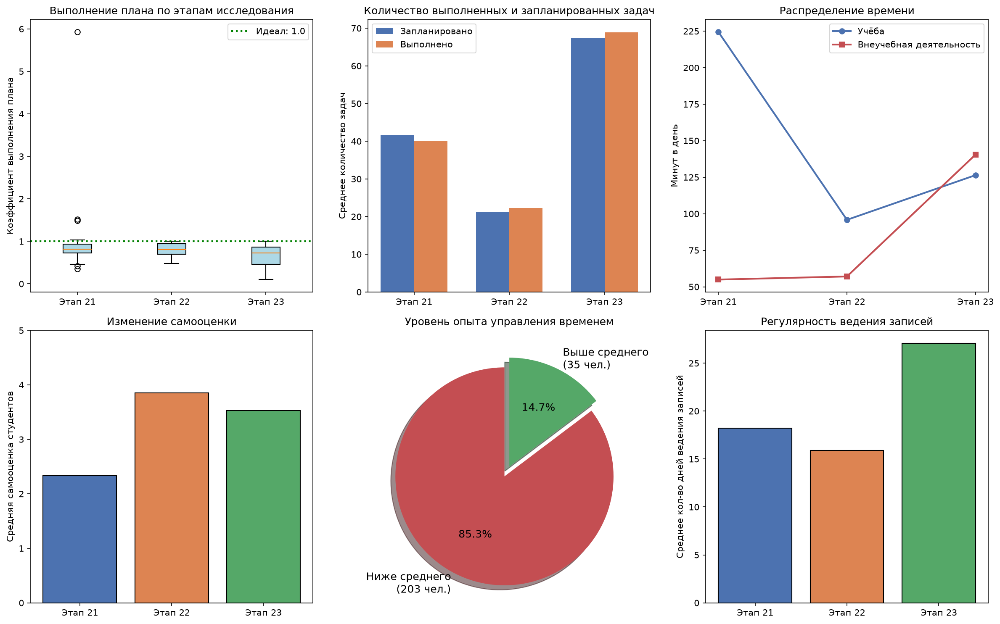

# Анализ актуальности проекта

**Цель анализа:** Обосновать актуальность и востребованность веб-приложения для комплексного планирования задач студентами на основе реальных поведенческих данных.

**Используемые инструменты:** 
*   Python 3
*   Библиотеки: `pandas`, `numpy`, `matplotlib`
*   Исходные данные: Датасет поведенческих метрик 238 студентов (3 этапа исследования DBR).

---

## Графики

---

## Анализ
Графики показывают что у 85% студентов опыт управления временем ниже среднего.

В начале эксперимента студенты переоценивали сколько задач они выполнят, учёба занимала большую часть времени и в среднем у них была низкая самооценка.

На 2 и 3 этапе, когда студенты начали планировать и отмечать выполненные задачи, видно, что на графике "Распределение времени" появился баланс. 

Студенты стали выполнять все запланированные задачи и их самооценка повысилась, когда планы стали реалистичными.

График "Регулярность ведения записей" показывает, что студенты готовы к ежедневному учёту задач

---

## Вывод

Проведенный анализ показывает актуальность проекта. 
Большинство студентов (85%) не имеют опыта управления временем. 

В начале эксперимента они переоценивали силы, и их самооценка падала, но когда у них появлялся инструмент для планирования (на 2 и 3 этапах), появлялся баланс, и они даже начинали перевыполнять план. 

Студенты готовы вести ежедневный учет, если у них есть удобный инструмент. 

---

## Структура папки
*   `analysis.py` — скрипт для обработки данных и генерации графиков.
*   `README.md` — этот файл с описанием и выводами.
*   `analysis_by_stages.png` — все графики.